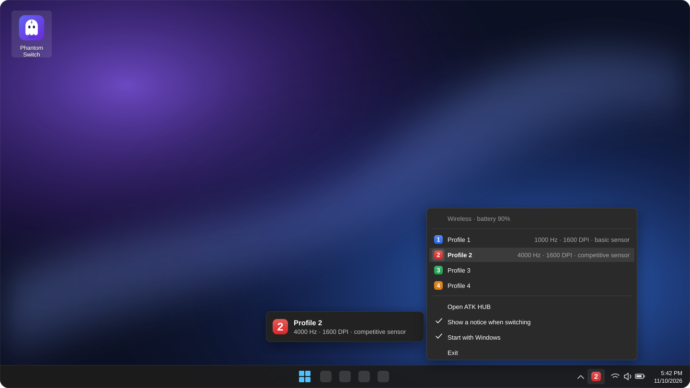

<div align="center">

# Phantom Switch

**Your ATK Phantom's profiles, one click from the clock.**

[](https://github.com/sbtcontreras/atk-phantom-profile-switcher/releases)
[](#compatibility)
[](LICENSE)

<br>



<sub>Illustration of the on-screen notice and the tray menu.</sub>

</div>

---

The ATK Phantom Ultimate keeps four profiles in its own memory — DPI, polling rate, sensor mode,
buttons — but moving between them means opening ATK HUB in a browser. **Phantom Switch** lives next
to the Windows clock and does it in one click: from your everyday profile to your competitive one
and back, with nothing to open, nothing to install, and nothing in the way of your mouse.

## Features

- **One click to switch.** The tray icon shows the active profile's number in its own color; a
  click takes you back to the profile you used before.
- **A notice where you are looking.** Each switch shows a small panel at the bottom of your screen
  with the profile, its polling rate, DPI and sensor mode — over games in borderless windows too.
- **Everything at a glance.** The menu shows how the mouse is connected, its battery and what each
  profile has, read from the mouse itself.
- **Warns you before the battery runs out**, below 15% and again below 5%.
- **At home in Windows.** Sharp at any display scaling, dark when Windows is dark, usable from the
  keyboard, in English or Spanish (it follows Windows' language).
- **Starts with Windows** if you want it to, with ATK HUB a click away.

## Download

Get **`PhantomSwitch.exe`** from [Releases](https://github.com/sbtcontreras/atk-phantom-profile-switcher/releases)
and run it. It is a single file under 400 KB: no installer, nothing written beside it.

> The first time, Windows may say "Windows protected your PC" because the app is not signed.
> Choose **More info › Run anyway**. Every release is built by GitHub from this very code, and each
> `.exe` is published with its SHA-256.

## Usage

Set up your profiles in [ATK HUB](https://hub.atk.pro/) as usual; Phantom Switch moves between them.

| | |
|---|---|
| **Click** the icon | Back to the profile you used before; the first time, it alternates between 1 and 2. |
| **Right-click** | The menu: connection and battery, the four profiles with what each one has, **Open ATK HUB**, **Show a notice when switching**, **Start with Windows** and **Exit**. |
| **Keyboard** | <kbd>Win</kbd> + <kbd>B</kbd> reaches the tray; <kbd>Enter</kbd> switches and the menu key opens the menu. |

The menu reads the mouse as it opens:

```text
Wireless · battery 90%
──────────────────────────────────────────────────────
  [1]  Profile 1      1000 Hz · 1600 DPI · basic sensor
● [2]  Profile 2      4000 Hz · 1600 DPI · competitive sensor
  [3]  Profile 3
  [4]  Profile 4
──────────────────────────────────────────────────────
       Open ATK HUB
       Show a notice when switching
       Start with Windows
       Exit
```

The active profile is read on the spot; the others show what they had the last time they were
active.

## Light by design

Phantom Switch is built to go unnoticed.

- **It never listens to your mouse or keyboard.** It sits nowhere between your mouse and your
  games: at 8000 Hz, every movement reaches Windows as if the app were not there.
- **At rest it does nothing.** Zero CPU and about 2 MB of memory. The notice only animates while it
  is on screen.
- **It talks to the mouse only when needed:** when you use the icon, when something is plugged in
  or out over USB, and, through the receiver, to check the battery every 15 minutes.
- **It never touches your settings.** It reads, and its only write is the one ATK HUB makes to
  switch profiles. Each request is sent once, never two switches at a time, and the active profile
  is never rewritten.

> Use ATK HUB or Phantom Switch, not both at once: the receiver serves one request at a time, so
> answers would get lost.

## Compatibility

- **ATK Phantom Ultimate** with BITMOUSE firmware, wired or through its 8K receiver. That is the
  tested model; other ATK mice with the same firmware may work through their receivers.
- **Windows 10 (1903 or later) and Windows 11.** No administrator rights needed.

## How it works

Phantom Switch talks to the mouse over HID with the same requests as ATK HUB's web app, read from
its public code. The protocol is documented in [`src/device/protocol.rs`](src/device/protocol.rs)
and tested against real answers from the mouse:

| Command | Purpose |
|---:|---|
| `9` | Active profile and its polling rate |
| `10` | Activate a profile |
| `7` · `15` | Battery · whether it is charging |
| `23` | Read the active profile's memory: DPI table and sensor mode |
| `177` | The mouse's features |

It is written in Rust, with no dependencies beyond the Windows APIs:

```text
src/
├── device/      the mouse: its protocol (no I/O, tested) and Windows' HID I/O
├── worker.rs    the thread that talks to the mouse; the interface never waits on it
├── app.rs       the interface and what is known of the mouse
├── tray.rs      the icon next to the clock
├── menu.rs      its menu
├── overlay.rs   the on-screen notice
├── badge.rs     the badge that stands for each profile
├── paint.rs     drawing: shapes, text, icons and bitmaps
└── …            texts in two languages, theme, settings
```

## Building

With [Rust](https://rustup.rs) on Windows:

```bash
cargo build --release
```

From Linux or WSL, with [`cargo-xwin`](https://github.com/rust-cross/cargo-xwin):
`cargo xwin build --release`. The executable lands in `target/x86_64-pc-windows-msvc/release/`.

Releases publish themselves: pushing a `vX.Y.Z` tag runs the tests, builds the app and uploads it
to Releases with that version's section of the [changelog](CHANGELOG.md) as its notes.

## License

[MIT](LICENSE). Phantom Switch is an independent project, not affiliated with ATK.
